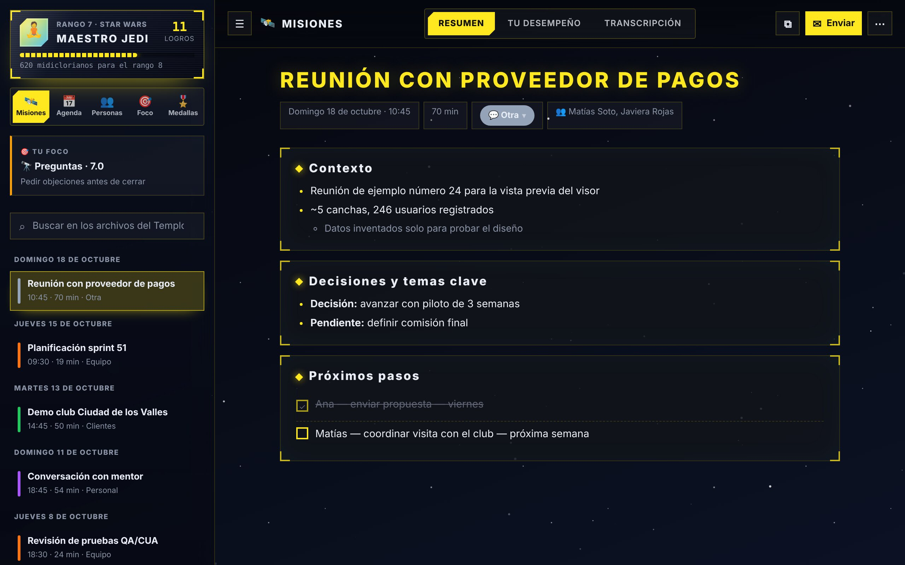
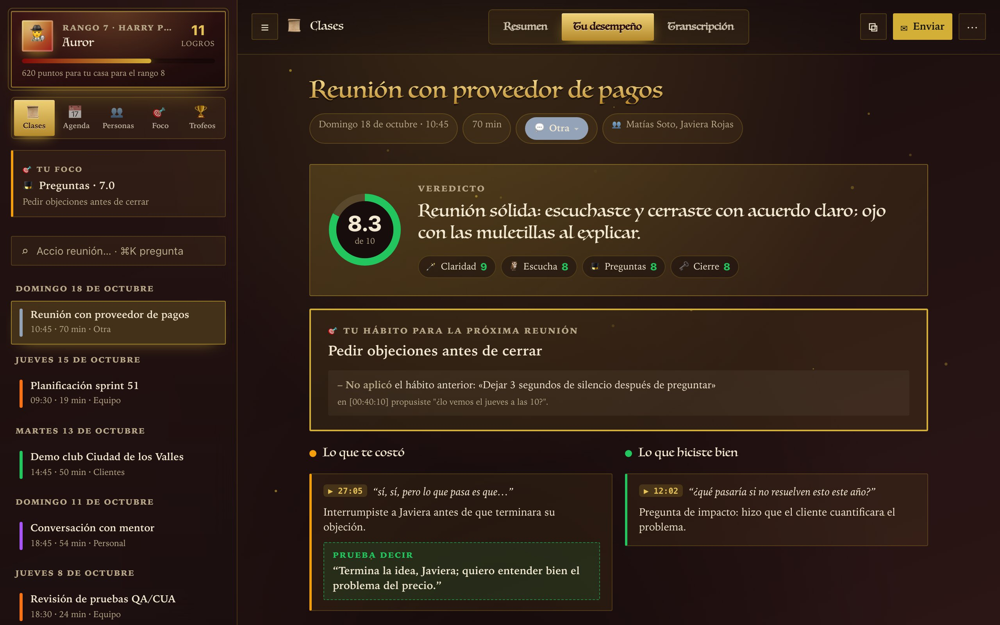
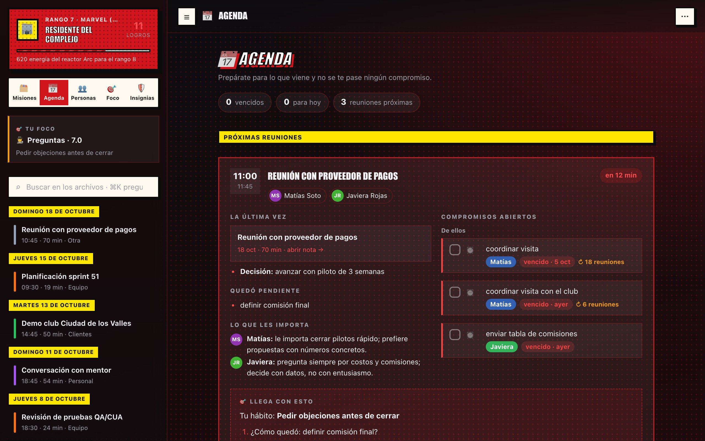

<p align="center"></p>

<h1 align="center">Minuta</h1>
<p align="center"><b>Sal de cada reunión con las notas listas y sabiendo cómo mejorar.</b><br>
Gratis · Open source (MIT) · Mac, Windows y Linux · Funciona con Claude, ChatGPT o Gemini · Tus datos no salen de tu computador</p>
<p align="center"><a href="https://github.com/minuta-app/minuta/releases/latest"><b>Descargar</b></a> · <a href="https://minuta-app.github.io/minuta/"><b>Página</b></a> · <a href="https://minuta-app.github.io/minuta/ia.html">Guía de tu IA</a> · <a href="#comunidad">Comunidad</a> · <a href="CONTRIBUTING.md">Cómo aportar</a> · <a href="#english">English</a></p>

<p align="center"></p>

---

Minuta graba tus reuniones (Teams, Zoom, Meet, Slack…), las **transcribe en tu propio computador** y le pide a **tu IA**
(Claude, ChatGPT o Gemini, con tu propia cuenta) notas, compromisos y un feedback honesto para que cada reunión te salga mejor
que la anterior. Mejoras subiendo de rango en tu saga favorita. Sin bots que entren a la llamada, sin cuentas de Minuta, sin servidores
y sin otra suscripción.

```
🎙️ Graba  →  📝 Transcribe en tu computador  →  🤖 Tu IA escribe (solo texto)  →  ✅ Notas, feedback y logros en tu carpeta
```

## Instalar

| | Con un comando | Descargando |
|---|---|---|
| 🍎 **Mac** | `curl -fsSL https://raw.githubusercontent.com/minuta-app/minuta/main/instalar.sh \| bash` (Terminal) | [`Minuta-macOS.zip`](https://github.com/minuta-app/minuta/releases/latest/download/Minuta-macOS.zip): descomprime y arrastra a Aplicaciones; la primera vez, si macOS dice que no pudo verificarla: **Ajustes del Sistema → Privacidad y seguridad → Abrir igualmente** |
| 🪟 **Windows** | `irm https://raw.githubusercontent.com/minuta-app/minuta/main/instalar.ps1 \| iex` (PowerShell) | [`Minuta-Windows.exe`](https://github.com/minuta-app/minuta/releases/latest/download/Minuta-Windows.exe): si aparece «Windows protegió tu PC», **Más información → Ejecutar de todas formas** |
| 🐧 **Linux** | `curl -fsSL https://raw.githubusercontent.com/minuta-app/minuta/main/instalar.sh \| bash` (sin sudo) | [`Minuta-Linux.AppImage`](https://github.com/minuta-app/minuta/releases/latest/download/Minuta-Linux.AppImage) (necesita FUSE: `sudo apt install libfuse2`) |

Los comandos bajan la última versión, verifican su huella SHA-256, la instalan solo para tu usuario y la abren.
Las descargas aún no están firmadas por Apple ni Microsoft; por eso el aviso la primera vez.

Al abrirla, un asistente te pregunta lo necesario: idioma, quién eres, tu IA, el modelo de transcripción (se descarga y verifica solo),
dónde guardar tus notas (carpeta nueva, una que ya tengas o tu repo de notas) y, si quieres, crea un respaldo privado en **tu** GitHub o GitLab.

**Requisitos:** tu IA con tu propia cuenta (una de estas) · ~1 GB libre, y además lo de tu sistema.

| Tu IA | Herramienta | Cuenta |
|---|---|---|
| Claude | [Claude Code](https://minuta-app.github.io/minuta/ia.html#claude) (`claude`) | Claude Pro o Max (o Team/Enterprise) |
| ChatGPT | [Codex](https://minuta-app.github.io/minuta/ia.html#codex) (`codex`) | Cualquier cuenta de ChatGPT, incluso la gratis (con límites) |
| Gemini *(beta)* | [Antigravity CLI](https://minuta-app.github.io/minuta/ia.html#gemini) (`agy`), o Gemini CLI con clave de API | Cuenta de Google |

¿Nunca usaste una de estas? La [guía de tu IA](https://minuta-app.github.io/minuta/ia.html) explica qué son y cómo instalarlas paso a paso, sin tecnicismos.

- **Mac:** chip Apple (M1 o posterior) y macOS 15+.
- **Windows:** Windows 10 u 11 de 64 bits. Git solo si quieres respaldar en GitHub/GitLab.
- **Linux:** x86_64 (Ubuntu 18.04+, Debian, Fedora…) con PulseAudio o PipeWire (`pulseaudio-utils` para grabar a los demás).

No hace falta Homebrew, Python ni ffmpeg: todo viene dentro de la app. En Windows y Linux la transcripción usa el procesador
(en Mac, el chip gráfico): el modelo «Liviano» va bien en casi cualquier computador. El calendario se conecta en Preferencias
pegando la dirección iCal secreta de Google Calendar u Outlook.

## Qué hace

| | |
|---|---|
| 🔔 **Detecta tus reuniones** | Te avisa al empezar (un clic y graba) y te pregunta si cortar cuando termina. En el panel eliges el tipo de reunión con las teclas 1–9, antes o durante la grabación. Puedes grabar otra mientras la anterior se procesa. |
| 📝 **Notas** | Temas, decisiones, pendientes y próximos pasos con responsable y fecha. Quién dijo qué, con las voces separadas. |
| 🎯 **Feedback** | Veredicto en una frase, lo que te costó con la cita exacta, qué probar la próxima vez, puntajes y un hábito por reunión. |
| ✎ **Corrige con tu IA** | Dile en palabras qué está mal («Matías no es el PO, es el Scrum Master») y tu IA arregla la nota; guarda una copia de la anterior y lo recuerda para las próximas reuniones. |
| 📈 **Tu foco y tu semana** | Tus puntajes reunión a reunión, antes vs. ahora, horas en reuniones por semana y un resumen semanal de tus tendencias que escribe tu IA. |
| ⏱️ **Coach en vivo** | Cuánto llevas hablando, tu % de habla y si cortaste a alguien, mientras pasa. |
| 📅 **Agenda y personas** | Prepara cada reunión con lo pendiente y los compromisos abiertos; los compromisos se marcan una vez y quedan al día en todas partes. |
| 🥊 **Gimnasio** | Ensaya hablando: la IA hace de la otra persona y te evalúa. |
| ✦ **Pregúntale a tus reuniones** | ⌘K: "¿qué le debo a Matías?", con la reunión y el minuto exacto. |
| ✉️ **Resumen para enviar** | Correo o mensaje para los participantes, solo con los hechos (nunca tu feedback privado). |
| 🪐 **Universos** | Rangos y logros con la estética que te guste. 4 incluidos, más en el [catálogo](https://github.com/minuta-app/minuta-catalogo), o crea el tuyo. |
| 🌐 **Idiomas** | Español e inglés incluidos; portugués, francés y otros se descargan. |

<p align="center"> </p>

## Privacidad

- **El audio nunca sale de tu computador.** La transcripción (whisper.cpp) y la separación de voces (FluidAudio en Mac, sherpa-onnx en Windows/Linux) corren ahí mismo.
- **Solo el texto** va a la IA que elegiste, directo y con tu propia cuenta (`claude -p`, `codex exec` o `agy -p`, en una carpeta temporal vacía y sin permisos para tocar archivos).
- **Tus notas son archivos Markdown tuyos** (funcionan con Obsidian). El respaldo opcional va a un repo privado de tu cuenta;
  el token queda cifrado con el llavero del sistema (Llavero en Mac, DPAPI en Windows, libsecret en Linux).
- Minuta no tiene servidores, cuentas ni telemetría. El catálogo de universos e idiomas es un repo público con JSON que la app valida al descargar.

Grabar a otras personas tiene reglas distintas según el país: avisa y pide consentimiento antes de grabar.

## Tus notas, tus reglas

Cada reunión es un archivo Markdown en tu carpeta y, si activas el respaldo, en **tu propio repositorio** de GitHub o GitLab.
No hay formato cerrado ni exportación pagada: puedes construir encima.

- **Ábrelas con lo que quieras:** Obsidian, VS Code o cualquier editor de Markdown.
- **Llévalas a donde te acomode:** Notion, Google Docs, Confluence o tu CRM importan Markdown; o súbelas con un script.
- **Arma tus herramientas:** el frontmatter trae fecha, tipo, participantes y métricas; los compromisos son casillas
  `- [ ] responsable — qué — cuándo (AAAA-MM-DD)`. Un script de pocas líneas los manda a tu gestor de tareas o arma tu tablero.
- **Pregúntale a tu IA por todo tu historial:** abre el repo de notas con Claude Code, Codex o Gemini CLI.
- **Automatiza en tu repo:** con GitHub Actions o GitLab CI, cada nota nueva puede avisar en Slack, actualizar una planilla, etc.

En [`ejemplos/`](ejemplos/) hay scripts listos para partir (por ejemplo, tus compromisos abiertos de todas las reuniones, o en CSV).
Si armas algo útil, compártelo en [Discussions → Show and tell](https://github.com/minuta-app/minuta/discussions/categories/muestra-lo-que-armaste).

### Formato de las notas

Archivo `AAAA-MM-DD HHMM - Título.md`:

```markdown
---
fecha: 2026-10-20            # día de la reunión
hora: 09:30
tipo: Equipo                 # el tipo de reunión que elegiste (tus categorías)
plataforma: Microsoft Teams  # si se detectó
duracion_min: 18.5
habla_yo_pct: 41             # % del tiempo que hablaste tú
palabras_por_min_yo: 142
preguntas_yo: 4
interrupciones_yo: 1
monologo_max_seg: 75
participantes: ["Matías", "Carla"]   # lista JSON, solo nombres
tags: [reunion, minuta]
---
# Alcance del sprint 12

### <Tema>
- hechos, decisiones (**Decisión:**) y pendientes (**Pendiente:**)

### Próximos pasos
- [ ] Ana — entregar el PDF — el jueves (2026-10-22)
- [x] Matías — priorizar el tablero — lunes

## Personas
- **Matías** (PO): qué le importa y cómo decide

## Feedback para Ana
- **Veredicto:** …
- 🔧 [00:00:20] "cita" — qué faltó → Prueba: "frase alternativa"
- ✅ [00:00:58] "cita" — por qué funcionó
- **Puntajes:** Claridad 6 · Escucha 7 · Preguntas 5 · Cierre 9
- **Hábito para la próxima:** …

## Métricas
| … | … |

## Transcripción
> [00:00:02] Ana: …
> [00:00:05] Matías: …
```

Los marcadores (`### Próximos pasos`, `## Personas`, `**Puntajes:**`…) van siempre en español aunque la nota esté en otro idioma,
así tus scripts funcionan igual. El feedback y `## Personas` son solo para ti: el mensaje para los participantes los omite.

## Actualizaciones

Minuta revisa sola si hay una versión nueva y te ofrece actualizar con un clic. Tus notas, perfil, universos y modelos viven fuera de la app,
así que actualizar no borra nada.

## Desarrollo

```bash
git clone https://github.com/minuta-app/minuta ~/minuta
cd ~/minuta && bash ./build.sh        # Mac: compila (Xcode 16+), empaqueta e instala en ~/Applications
cd ui && python3 -m http.server 8765  # vista previa de la interfaz con datos ficticios: http://localhost:8765
```

- `app/` app de macOS en Swift (SwiftPM) · `bin/` procesamiento en Python (solo biblioteca estándar) · `ui/` interfaz web ·
  `universos/` universos incluidos · `herramientas/` empaquetado y revisión de privacidad · `docs/` sitio.
- Con `~/minuta` como checkout git, la app usa ese código y se actualiza con `git pull`.
- Publicar una versión: sube la versión en `app/Info.plist` y `escritorio/package.json` y súbelo a `main`; GitHub Actions compila Mac, Windows y Linux y crea la Release.
- La guía completa para contribuir (arquitectura, reglas, agentes) está en [`AGENTS.md`](AGENTS.md).
- **Capturas:** `node herramientas/capturas.mjs` rehace las de `docs/img` (y la imagen para compartir) desde la vista previa, con los datos ficticios.
- **Pruebas:** `bash pruebas/correr.sh` corre lo mismo que GitHub revisa en cada cambio (sintaxis, privacidad, contrato entre la
  interfaz y las apps, pruebas de Python y de la interfaz en español e inglés con todos los universos). `python3 pruebas/evaluar_ia.py --real`
  prueba el prompt de las notas con tu IA y transcripciones ficticias.

**Windows y Linux** (`escritorio/`, Electron):

```bash
cd escritorio && npm install
bash herramientas/preparar.sh linux     # o windows: Python portátil, whisper (compilado con zig) y separador de voces
npx electron .                          # en desarrollo
npx electron-builder --linux AppImage tar.gz                                        # paquetes de Linux
npx electron-builder --win dir && bash herramientas/instalador-windows.sh           # instalador de Windows (makensis, sin Wine)
```

Comentarios y errores: desde la app (⋯ → Enviar comentarios) o en [issues](https://github.com/minuta-app/minuta/issues).

<a id="comunidad"></a>
## Comunidad

Minuta es gratis y abierta, y la hacemos entre todos. Casi ninguna forma de sumarte exige programar:

- 💬 **Conversa** en [Discussions](https://github.com/minuta-app/minuta/discussions): preguntas, ideas y consejos entre quienes la usan.
- 🧩 **Muestra lo que armaste** con tus notas (scripts, tableros, automatizaciones) en [Show and tell](https://github.com/minuta-app/minuta/discussions/categories/muestra-lo-que-armaste).
- 🗳️ **Vota los universos** desde la galería de la app (o en los [issues de votos](https://github.com/minuta-app/minuta-catalogo/issues?q=is%3Aissue+label%3Avotos)).
- 🌌 **Crea un universo** (Universos → Crear universo) y propónlo al [catálogo](https://github.com/minuta-app/minuta-catalogo) con 📤.
- 🌍 **Traduce** la interfaz: los idiomas viven en el [catálogo](https://github.com/minuta-app/minuta-catalogo/tree/main/idiomas).
- 🐞 **Cuéntanos** qué falló o qué te gustaría, desde la app o en [issues](https://github.com/minuta-app/minuta/issues/new/choose).
- 🛠️ **Programa, con o sin IA:** [`AGENTS.md`](AGENTS.md) es la guía del proyecto para personas y para cualquier IA de programación
  (Claude Code, Codex, Gemini/Antigravity). Empieza por [CONTRIBUTING.md](CONTRIBUTING.md) y los issues
  [`good first issue`](https://github.com/minuta-app/minuta/labels/good%20first%20issue).

🔒 ¿Encontraste una falla de seguridad? Avísanos en privado: [SECURITY.md](SECURITY.md).

Al participar aceptas el [código de conducta](CODE_OF_CONDUCT.md).

---

<a id="english"></a>
## English

**Minuta** is a free, open-source meeting notes app and communication coach for Mac, Windows and Linux. It records your meetings,
**transcribes them locally** (whisper.cpp + speaker separation), and uses the AI you choose — Claude (Claude Code), ChatGPT (Codex)
or Gemini (Antigravity CLI, beta), with your own account — to give you
notes, commitments, and honest, quote-backed feedback. Audio never leaves your computer; notes are plain Markdown files you own,
optionally backed up to a private repo in your own GitHub or GitLab account — so you can open them in Obsidian, import them into
Notion or Google Docs, or build your own tools and automations on top ([format](#formato-de-las-notas)). No Minuta accounts, servers or telemetry.

**Install:** Mac and Linux: `curl -fsSL https://raw.githubusercontent.com/minuta-app/minuta/main/instalar.sh | bash` ·
Windows (PowerShell): `irm https://raw.githubusercontent.com/minuta-app/minuta/main/instalar.ps1 | iex` ·
or download from the [latest release](https://github.com/minuta-app/minuta/releases/latest). Requires one of Claude Code, Codex or Antigravity CLI with your own account ([setup guide](https://minuta-app.github.io/minuta/ia.html));
Mac needs Apple silicon and macOS 15+, Windows 10/11 64-bit, Linux x86_64 with PulseAudio or PipeWire.
The interface ships in Spanish and English (more languages downloadable). The code and comments are in Spanish.

**What it does:** detects Teams, Zoom, Meet or Slack meetings and offers to record (no bot joins the call) · notes with topics, decisions
and next steps with owner and date, with voices separated · feedback with a one-line verdict, exact quotes, scores and one habit for next
time · live coach (talk time, interruptions) · agenda that prepares each meeting with open commitments, plus a card for each person ·
a practice gym where your AI plays the other person · ⌘K to ask your meetings, citing the exact minute · a facts-only message for
participants (never your private feedback) · fix a note by telling your AI what's wrong · your scores over time and a weekly summary ·
ranks and achievements in universes (Star Wars, Marvel, Harry Potter, movies; more in the [catalog](https://github.com/minuta-app/minuta-catalogo), or create your own).

Security issues: please report them privately, see [SECURITY.md](SECURITY.md).

## Licencia / License

[MIT](LICENSE)
