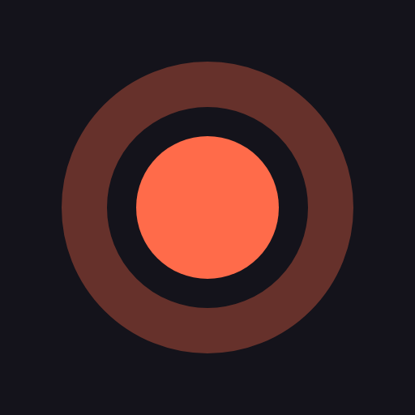
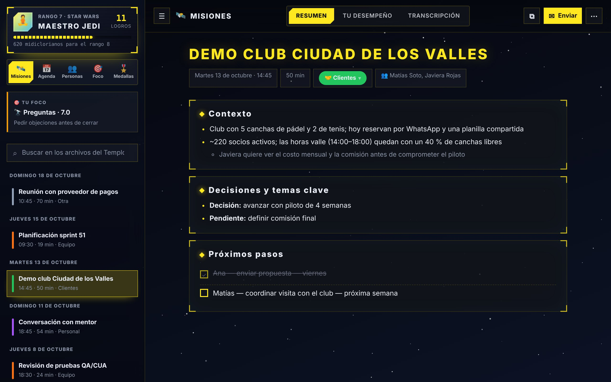
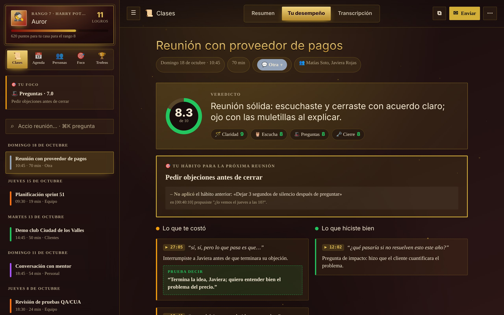
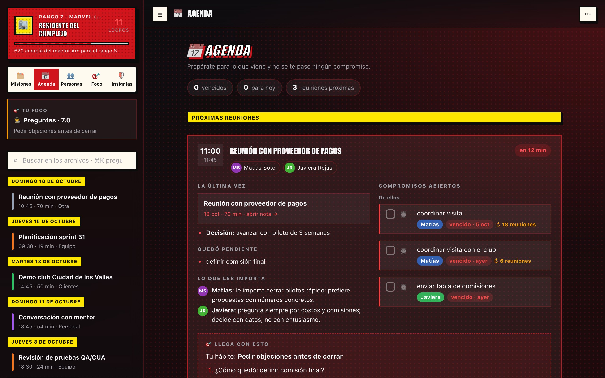

<p align="center"></p>

<h1 align="center">Minuta</h1>
<p align="center"><b>Sal de cada reunión con las notas listas y sabiendo cómo mejorar.</b><br>
Gratis · Open source (AGPL-3.0) · Mac, Windows y Linux · Funciona con Claude, ChatGPT o Gemini · Tus datos no salen de tu computador</p>
<p align="center"><a href="https://github.com/minuta-app/minuta/releases/latest"><b>Descargar</b></a> · <a href="https://minuta-app.github.io/minuta/"><b>Página</b></a> · <a href="https://minuta-app.github.io/minuta/ia.html">Guía de tu IA</a> · <a href="https://github.com/minuta-app/minuta/wiki">Wiki</a> · <a href="#comunidad">Comunidad</a> · <a href="CONTRIBUTING.md">Cómo aportar</a> · <a href="#english">English</a></p>

<p align="center"></p>

---

Minuta hace tres cosas:
1. Graba tus reuniones (Teams, Zoom, Meet, Slack…).
2. Las **transcribe en tu propio computador**.
3. Le pide a **tu IA** (Claude, ChatGPT o Gemini, con tu propia cuenta) las notas, los compromisos y un feedback honesto.

Así, cada reunión te sale mejor que la anterior. A medida que mejoras, subes de rango en el universo que elijas. No entra ningún bot
a la llamada. No hay cuentas de Minuta, servidores ni otra suscripción.

```
🎙️ Graba  →  📝 Transcribe en tu computador  →  🤖 Tu IA escribe (solo texto)  →  ✅ Notas, feedback y logros en tu carpeta
```

## Instalar

| | Con un comando | Descargando |
|---|---|---|
| 🍎 **Mac** | `curl -fsSL https://raw.githubusercontent.com/minuta-app/minuta/main/instalar.sh \| bash` (Terminal) | [`Minuta-macOS.zip`](https://github.com/minuta-app/minuta/releases/latest/download/Minuta-macOS.zip): descomprime y arrastra a Aplicaciones; la primera vez, si macOS dice que no pudo verificarla: **Ajustes del Sistema → Privacidad y seguridad → Abrir igualmente** |
| 🪟 **Windows** | `irm https://raw.githubusercontent.com/minuta-app/minuta/main/instalar.ps1 \| iex` (PowerShell) | [`Minuta-Windows.exe`](https://github.com/minuta-app/minuta/releases/latest/download/Minuta-Windows.exe): si aparece «Windows protegió tu PC», **Más información → Ejecutar de todas formas** |
| 🐧 **Linux** | `curl -fsSL https://raw.githubusercontent.com/minuta-app/minuta/main/instalar.sh \| bash` (sin sudo) | [`Minuta-Linux.AppImage`](https://github.com/minuta-app/minuta/releases/latest/download/Minuta-Linux.AppImage) (necesita FUSE: `sudo apt install libfuse2`) |

Los comandos hacen esto:
1. Bajan la última versión.
2. Verifican su huella SHA-256.
3. La instalan solo para tu usuario.
4. La abren.

Las descargas todavía no tienen firma de Apple ni de Microsoft. Por eso aparece un aviso la primera vez.

Al abrir Minuta, un asistente te pregunta lo necesario:
1. El idioma.
2. Quién eres.
3. Tu IA.
4. El modelo de transcripción. Minuta lo descarga y lo verifica sola.
5. Dónde guardar tus notas: una carpeta nueva, una que ya tengas o tu repo de notas.
6. Si quieres, un respaldo privado en **tu** GitHub o GitLab.

**Requisitos:** tu IA con tu propia cuenta (una de estas) y ~1 GB libre. Además, lo que pide tu sistema (abajo).

| Tu IA | Herramienta | Cuenta |
|---|---|---|
| Claude | [Claude Code](https://minuta-app.github.io/minuta/ia.html#claude) (`claude`) | Claude Pro o Max (o Team/Enterprise) |
| ChatGPT | [Codex](https://minuta-app.github.io/minuta/ia.html#codex) (`codex`) | Cualquier cuenta de ChatGPT, incluso la gratis (con límites) |
| Gemini *(beta)* | [Antigravity CLI](https://minuta-app.github.io/minuta/ia.html#gemini) (`agy`), o Gemini CLI con clave de API | Cuenta de Google |

¿Nunca usaste una de estas? La [guía de tu IA](https://minuta-app.github.io/minuta/ia.html) explica qué son y cómo instalarlas,
paso a paso y sin tecnicismos.

- **Mac:** chip Apple (M1 o posterior) y macOS 15+.
- **Windows:** Windows 10 u 11 de 64 bits. Git solo si quieres respaldar en GitHub/GitLab.
- **Linux:** x86_64 (Ubuntu 18.04+, Debian, Fedora…) con PulseAudio o PipeWire (`pulseaudio-utils` para grabar a los demás).

No necesitas Homebrew, Python ni ffmpeg: todo viene dentro de la app.

En Windows y Linux, la transcripción usa el procesador. En Mac usa el chip gráfico. El modelo «Liviano» funciona bien en casi
cualquier computador.

Para conectar el calendario, ve a Preferencias y pega la dirección iCal secreta de Google Calendar u Outlook.

## Qué hace

| | |
|---|---|
| 🔔 **Detecta tus reuniones** | Te avisa al empezar (un clic y graba) y te pregunta si cortar cuando termina. En el panel eliges el tipo de reunión con las teclas 1–9, antes o durante la grabación. Puedes grabar otra mientras la anterior se procesa. |
| 📝 **Notas** | Temas, decisiones, pendientes y próximos pasos con responsable y fecha. Quién dijo qué, con las voces separadas. |
| 🎯 **Feedback** | Veredicto en una frase, lo que te costó con la cita exacta, qué probar la próxima vez, puntajes y un hábito por reunión. |
| ✎ **Corrige con tu IA** | Dile en palabras qué está mal («Matías no es el PO, es el Scrum Master») y tu IA arregla la nota; guarda una copia de la anterior y lo recuerda para las próximas reuniones. |
| 📈 **Tu foco y tu semana** | Tus puntajes reunión a reunión, antes vs. ahora, horas en reuniones por semana y un resumen semanal de tus tendencias que escribe tu IA. |
| ⏱️ **Coach en vivo** | Cuánto llevas hablando, tu % de habla y si cortaste a alguien, mientras pasa. |
| 📅 **Agenda y personas** | Prepara cada reunión con lo pendiente y los compromisos abiertos; los compromisos se marcan una vez y quedan al día en todas partes. |
| 🥊 **Gimnasio** | Ensaya hablando: la IA hace de la otra persona y te evalúa. |
| ✦ **Pregúntale a tus reuniones** | ⌘K: "¿qué le debo a Matías?", con la reunión y el minuto exacto. |
| ✉️ **Resumen para enviar** | Correo o mensaje para los participantes, solo con los hechos (nunca tu feedback privado). |
| 🪐 **Universos** | Rangos y logros con la estética que te guste. 4 incluidos, más en el [catálogo](https://github.com/minuta-app/minuta-catalogo), o crea el tuyo. |
| 🌐 **Idiomas** | Español e inglés incluidos; portugués, francés y otros se descargan. |

<p align="center"> </p>

## Privacidad

- **El audio nunca sale de tu computador.** La transcripción (whisper.cpp) corre ahí mismo. La separación de voces también
  (FluidAudio en Mac, sherpa-onnx en Windows y Linux).
- **Solo el texto** va a la IA que elegiste, directo y con tu propia cuenta (`claude -p`, `codex exec` o `agy -p`). La IA corre en
  una carpeta temporal vacía, sin permisos para tocar archivos.
- **Tus notas son archivos Markdown tuyos.** Funcionan con Obsidian.
- **El respaldo es opcional** y va a un repo privado de tu cuenta. El token queda cifrado con el llavero del sistema (Llavero en
  Mac, DPAPI en Windows, libsecret en Linux).
- Minuta no tiene servidores, cuentas ni telemetría.
- El catálogo de universos e idiomas es un repo público con JSON. La app lo valida al descargar.

> **Antes de grabar:** las reglas para grabar a otras personas cambian según el país. Avisa y pide consentimiento.

## Tus notas, tus reglas

Cada reunión es un archivo Markdown en tu carpeta. Si activas el respaldo, también queda en **tu propio repositorio** de GitHub o
GitLab. No hay formato cerrado ni exportación pagada: puedes construir encima.

- **Ábrelas con lo que quieras:** Obsidian, VS Code o cualquier editor de Markdown.
- **Llévalas a donde te acomode:** Notion, Google Docs, Confluence o tu CRM importan Markdown; o súbelas con un script.
- **Arma tus herramientas:** el frontmatter trae fecha, tipo, participantes y métricas. Los compromisos son casillas:
  `- [ ] responsable — qué — cuándo (AAAA-MM-DD)`. Un script de pocas líneas los manda a tu gestor de tareas o arma tu tablero.
- **Pregúntale a tu IA por todo tu historial:** abre el repo de notas con Claude Code, Codex o Gemini CLI.
- **Automatiza en tu repo:** con GitHub Actions o GitLab CI, cada nota nueva puede avisar en Slack, actualizar una planilla, etc.

En [`ejemplos/`](ejemplos/) hay scripts listos para partir. Por ejemplo: tus compromisos abiertos de todas las reuniones, o en CSV.
Si armas algo útil, compártelo en [Discussions → Show and tell](https://github.com/minuta-app/minuta/discussions/categories/muestra-lo-que-armaste).

### Formato de las notas

Archivo `AAAA-MM-DD HHMM - Título.md`:

```markdown
---
fecha: 2026-10-20            # día de la reunión
hora: 09:30
tipo: Equipo                 # el tipo de reunión que elegiste (tus categorías)
plataforma: Microsoft Teams  # si se detectó
duracion_min: 18.5
habla_yo_pct: 41             # % del tiempo que hablaste tú
palabras_por_min_yo: 142
preguntas_yo: 4
interrupciones_yo: 1
monologo_max_seg: 75
participantes: ["Matías", "Carla"]   # lista JSON, solo nombres
tags: [reunion, minuta]
---
# Alcance del sprint 12

### <Tema>
- hechos, decisiones (**Decisión:**) y pendientes (**Pendiente:**)

### Próximos pasos
- [ ] Ana — entregar el PDF — el jueves (2026-10-22)
- [x] Matías — priorizar el tablero — lunes

## Personas
- **Matías** (PO): qué le importa y cómo decide

## Feedback para Ana
- **Veredicto:** …
- 🔧 [00:00:20] "cita" — qué faltó → Prueba: "frase alternativa"
- ✅ [00:00:58] "cita" — por qué funcionó
- **Puntajes:** Claridad 6 · Escucha 7 · Preguntas 5 · Cierre 9
- **Hábito para la próxima:** …

## Métricas
| … | … |

## Transcripción
> [00:00:02] Ana: …
> [00:00:05] Matías: …
```

Los marcadores (`### Próximos pasos`, `## Personas`, `**Puntajes:**`…) siempre van en español, aunque la nota esté en otro idioma.
Así tus scripts funcionan igual. El feedback y `## Personas` son solo para ti: el mensaje para los participantes no los incluye.

## Actualizaciones

- Minuta revisa sola si hay una versión nueva: al abrir y cada 6 horas.
- Te ofrece actualizar con un clic, dentro de la app.
- Solo baja de los [Releases](https://github.com/minuta-app/minuta/releases) de este repo. Revisa la huella SHA-256 antes de
  instalar.
- Si estás grabando o generando notas, espera a que termines.
- Tus notas, tu perfil, los universos, los modelos, las cuentas conectadas y los permisos viven fuera de la app. Actualizar no borra
  nada.

**Qué permisos pide y a qué sale a internet:** la lista completa, en palabras simples, está en las
[preguntas frecuentes de la página](https://minuta-app.github.io/minuta/#preguntas).

## Desarrollo

```bash
git clone https://github.com/minuta-app/minuta ~/minuta
cd ~/minuta && bash ./build.sh        # Mac: compila (Xcode 16+), empaqueta e instala en ~/Applications
cd ui && python3 -m http.server 8765  # vista previa de la interfaz con datos ficticios: http://localhost:8765
```

- Las carpetas:
  - `app/`: la app de macOS, en Swift (SwiftPM).
  - `bin/`: el procesamiento, en Python (solo biblioteca estándar).
  - `ui/`: la interfaz web.
  - `universos/`: los universos incluidos.
  - `herramientas/`: el empaquetado y la revisión de privacidad.
  - `docs/`: el sitio.
- Si `~/minuta` es un checkout git, la app usa ese código y se actualiza con `git pull`. En Mac, `build.sh` deja la ruta del checkout
  en `~/minuta/desarrollo` para el actualizador.
- La parte nativa corre sobre las piezas de [Pieza](https://github.com/pieza-app/pieza): `host-escritorio` (Windows y Linux) y lo
  que calza de `host-mac` (Mac). Las acciones que solo corren un script se declaran en `app.json` → `acciones`. Ver «Piezas» en
  [`AGENTS.md`](AGENTS.md).
- Minuta todavía no usa «host-tauri», el host nuevo de Pieza. Antes necesita un ayudante en Swift para grabar el audio del sistema,
  separar voces y el dictado en el Mac.
- Para publicar una versión:
  1. Sube la versión en `app/Info.plist` y en `escritorio/package.json`.
  2. Sube el cambio a `main`.
  3. GitHub Actions compila Mac, Windows y Linux y crea la Release.
- La guía completa para contribuir (arquitectura, reglas, agentes) está en [`AGENTS.md`](AGENTS.md).
- **Capturas:** `node herramientas/capturas.mjs` rehace las de `docs/img` (y la imagen para compartir) desde la vista previa, con los datos ficticios.
- **Pruebas:** `bash pruebas/correr.sh` corre lo mismo que GitHub revisa en cada cambio: sintaxis, privacidad, el contrato entre la
  interfaz y las apps, las pruebas de Python y las de la interfaz (en español e inglés, con todos los universos).
  `python3 pruebas/evaluar_ia.py --real` prueba el prompt de las notas con tu IA y transcripciones ficticias.

**Windows y Linux** (`escritorio/`, Electron):

```bash
cd escritorio && npm install
bash herramientas/preparar.sh linux     # o windows: Python portátil, whisper (compilado con zig) y separador de voces
npx electron .                          # en desarrollo
HOME=$(mktemp -d) xvfb-run -a node pruebas/puente.mjs   # el puente, las acciones declaradas y la grabadora (Linux, con Playwright)
npx electron-builder --linux AppImage tar.gz                                        # paquetes de Linux
npx electron-builder --win dir && bash herramientas/instalador-windows.sh           # instalador de Windows (makensis, sin Wine)
```

Comentarios y errores: desde la app (⋯ → Enviar comentarios) o en [issues](https://github.com/minuta-app/minuta/issues).

<a id="comunidad"></a>
## Comunidad

Minuta es gratis y abierta. La hacemos entre todos. Casi ninguna forma de sumarte exige programar:

- 💬 **Conversa** en [Discussions](https://github.com/minuta-app/minuta/discussions): preguntas, ideas y consejos entre quienes la usan.
- 🧩 **Muestra lo que armaste** con tus notas (scripts, tableros, automatizaciones) en [Show and tell](https://github.com/minuta-app/minuta/discussions/categories/muestra-lo-que-armaste).
- 🗳️ **Vota los universos** desde la galería de la app (o en los [issues de votos](https://github.com/minuta-app/minuta-catalogo/issues?q=is%3Aissue+label%3Avotos)).
- 🌌 **Crea un universo** (Universos → Crear universo) y propónlo al [catálogo](https://github.com/minuta-app/minuta-catalogo) con 📤.
- 🌍 **Traduce** la interfaz: los idiomas viven en el [catálogo](https://github.com/minuta-app/minuta-catalogo/tree/main/idiomas).
- 🐞 **Cuéntanos** qué falló o qué te gustaría, desde la app o en [issues](https://github.com/minuta-app/minuta/issues/new/choose).
- 🛠️ **Programa, con o sin IA:** [`AGENTS.md`](AGENTS.md) es la guía del proyecto para personas y para cualquier IA de programación
  (Claude Code, Codex, Gemini/Antigravity). Empieza por [CONTRIBUTING.md](CONTRIBUTING.md) y los issues
  [`good first issue`](https://github.com/minuta-app/minuta/labels/good%20first%20issue).

🔒 ¿Encontraste una falla de seguridad? Avísanos en privado: [SECURITY.md](SECURITY.md).

Al participar, aceptas el [código de conducta](CODE_OF_CONDUCT.md).

---

<a id="english"></a>
## English

**Minuta** is a free, open-source meeting notes app and communication coach for Mac, Windows and Linux.
1. It records your meetings.
2. It **transcribes them locally** (whisper.cpp and speaker separation).
3. It asks the AI you choose for notes, commitments and honest feedback with exact quotes. The AI is Claude (Claude Code), ChatGPT
   (Codex) or Gemini (Antigravity CLI, beta), with your own account.

Audio never leaves your computer. Notes are plain Markdown files you own. You can back them up to a private repo in your own GitHub
or GitLab account. Open them in Obsidian, import them into Notion or Google Docs, or build your own tools on top
([format](#formato-de-las-notas)). There are no Minuta accounts, servers or telemetry.

**Install:**
- Mac and Linux: `curl -fsSL https://raw.githubusercontent.com/minuta-app/minuta/main/instalar.sh | bash`
- Windows (PowerShell): `irm https://raw.githubusercontent.com/minuta-app/minuta/main/instalar.ps1 | iex`
- Or download from the [latest release](https://github.com/minuta-app/minuta/releases/latest).

**Requirements:** Claude Code, Codex or Antigravity CLI with your own account ([setup guide](https://minuta-app.github.io/minuta/ia.html)).
Mac needs Apple silicon and macOS 15+. Windows needs 10/11 64-bit. Linux needs x86_64 with PulseAudio or PipeWire. The interface
ships in Spanish and English; more languages are downloadable. The code and comments are in Spanish.

**What it does:**
- Detects Teams, Zoom, Meet or Slack meetings and offers to record. No bot joins the call.
- Notes with topics, decisions and next steps (with owner and date). Voices are separated.
- Feedback with a one-line verdict, exact quotes, scores and one habit for next time.
- A live coach: talk time and interruptions.
- An agenda that prepares each meeting with open commitments, and a card for each person.
- A practice gym: your AI plays the other person.
- ⌘K to ask your meetings, with the exact minute.
- A facts-only message for participants. It never includes your private feedback.
- Fix a note by telling your AI what's wrong.
- Your scores over time and a weekly summary.
- Ranks and achievements in universes. 4 are included (Star Wars, Marvel, Harry Potter, movies). More are in the [catalog](https://github.com/minuta-app/minuta-catalogo), or create your own.

**Updates:** Minuta checks for new versions on its own and offers a one-click update inside the app. It only downloads from this
repo's Releases and checks the SHA-256 fingerprint first. Your notes, profile, universes, models, connected accounts and permissions
stay untouched. For the permissions it asks for and what it connects to, see the [FAQ on the website](https://minuta-app.github.io/minuta/#preguntas).

Security issues: please report them privately, see [SECURITY.md](SECURITY.md).

## Licencia / License

[AGPL-3.0](LICENSE). Desde la 0.4.0, Minuta es AGPL-3.0; las versiones publicadas hasta la 0.3.1 siguen bajo MIT.
*Starting with 0.4.0, Minuta is AGPL-3.0; versions published up to 0.3.1 remain under MIT.*

---

[](https://pieza-app.github.io/pieza/) · Las piezas comunes (la app nativa, tu IA, idiomas, actualizaciones…) viven en [Pieza](https://github.com/pieza-app/pieza).
[](https://pieza-app.github.io/pieza/) · *The shared pieces (the native app, your AI, languages, updates…) live in Pieza.*
